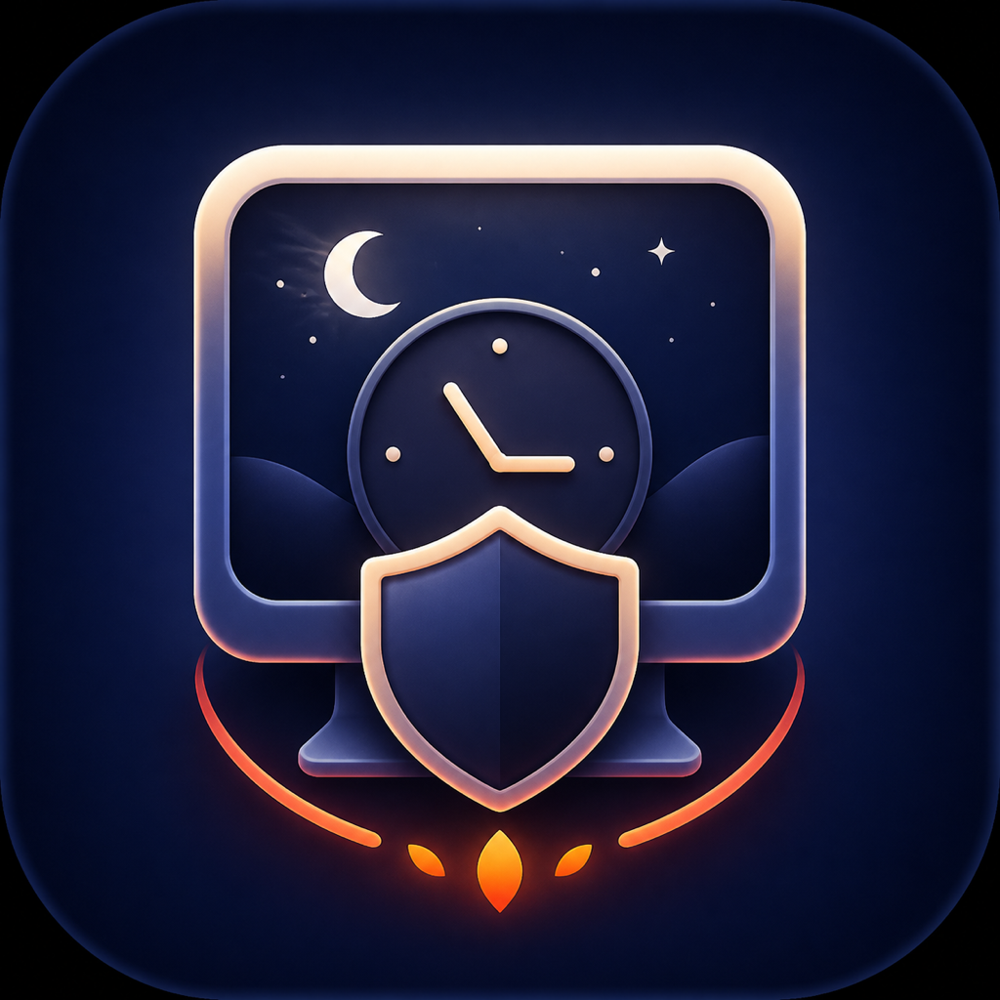

# Mastbound for macOS



Mastbound is a free, open-source commitment blocker for the Mac. It ships
with a list of adult websites. You choose how long the block lasts, from one
day to one year (one hour at least from Terminal). The block then stays on until that time is over, even if
you quit or delete the app or restart the Mac. Ending early takes more than
an hour of deliberate friction, and then the block stays on for 72 more hours.

Mastbound makes the block hard to undo on impulse. **It cannot make the block
impossible to undo.** An administrator of a Mac can always remove it. Read
[What Mastbound cannot do](#what-mastbound-cannot-do) before you use it.

## Status

Version 0.1.2. It needs macOS 14 or later.

New in 0.1.2: forced SafeSearch on Google, Bing and DuckDuckGo during a
commitment, so their image results are filtered too.

Tested in a macOS VM (see [docs/verification.md](docs/verification.md)):
restarts, power cuts, clock changes, VM suspend, the full early-end flow with
both password prompts, the Login Items switch, and Chrome and Firefox with
DNS over HTTPS forced on. Not tested yet: sleep on a real Mac, Safari
itself, VPNs, iCloud Private Relay, and Intel Macs.

## Install

1. Download `Mastbound-0.1.1.dmg` from
   [Releases](https://github.com/Aperturesurvivor/mastbound/releases).
2. Open it and drag Mastbound to Applications.
3. Open Mastbound, choose a duration and click Start. macOS asks for an
   administrator password to install the background service.

The app is signed with a Developer ID and notarized by Apple.

macOS lists the service as "mastboundd" under System Settings → General →
Login Items & Extensions. Leave it on. If it is turned off, the block stays,
but the commitment cannot end until it is on again; the app shows this.

## Remove

When no commitment is active:

```sh
sudo /Library/PrivilegedHelperTools/Mastbound/mastboundctl uninstall
```

Then move Mastbound from Applications to the Trash. Deleting the app alone
does not remove the service or the block.

## How it works

- A small root service (`mastboundd`) runs under `launchd`. Every 5 seconds
  it makes one marked section of `/etc/hosts` match the commitment. If
  someone edits that section, the service puts it back.
- The same section turns on forced SafeSearch: Google, Bing and DuckDuckGo
  search names point to each provider's filtering server, which removes
  explicit results, images included. The page and account settings cannot
  turn it off.
- The service and its files live in root-owned folders, not inside the app.
  Deleting the app does not stop the block.
- Time is counted with the Mac's monotonic clock. Changing the date or time
  in System Settings does not shorten the commitment.
- Any error keeps the block in place. A missing or damaged state file is
  treated as damage, not as "no commitment".
- At the end of the commitment the service removes its block by itself.
- The service never uses the network and never runs a shell.

Files:

| Path | Content |
| --- | --- |
| `/Library/PrivilegedHelperTools/Mastbound/` | `mastboundd`, `mastboundctl`, the installed list |
| `/Library/Application Support/Mastbound/state.json` | Commitment state, root only |
| `/Library/Application Support/Mastbound/status.json` | Phase and end date, readable by everyone |
| `/Library/LaunchDaemons/com.josiahwilson.mastbound.plist` | The `launchd` job |
| `/etc/hosts` | One section between `# BEGIN MASTBOUND — MANAGED BLOCK` and `# END MASTBOUND — MANAGED BLOCK` |
| `/etc/resolver/` | One file per top site and per search host name, each starting with `# Mastbound: managed file` |

## Commands

```
mastboundctl status
mastboundctl version
mastboundctl install
mastboundctl start  (--minutes N | --hours N | --days N)
mastboundctl extend (--minutes N | --hours N | --days N)
mastboundctl recover --cancel     (no password needed)
mastboundctl recover --begin      (used by the app's early-end flow)
mastboundctl recover --finish PHRASE  (only 1 hour or more after --begin)
mastboundctl uninstall
```

All commands except `status`, `version` and `recover --cancel` need `sudo`.

- `start` installs the service if needed and starts a commitment. The
  minimum is 1 hour. The maximum is 365 days.
- `extend` adds time. It can never take time away. The time left can never
  pass 365 days.
- `uninstall` works only when no commitment is active.

### Early exit (recovery)

For real problems, such as a wrong site in the list or a Mac you must sell,
there is one slow way out, in the app. It is long and unpleasant on purpose,
and it ends in a 72-hour wait.

"End early" under the countdown starts it. It has 10 steps:

1. Read what will happen, then enter the admin password. This starts a
   clock in the Mastbound service. Nothing is unblocked.
2. Agree to 12 statements, such as "I'm quitting because I care more about
   my carnal desires than human connection.", one at a time, each after a few seconds.
   Every third one must be typed out in full.
3. Type 5 distorted codes.
4. Work out 5 sums such as `47 × 38 − 512` without a calculator.
5. Find every square with a given digit in 3 grids.
6. Write 3 answers of at least 150 characters each, at least 1 minute each.
7. Wait 15 minutes with nothing to do.
8. Hold a button down for 90 seconds; letting go starts it again.
9. Type the number of full days left and `I want to end my commitment early`.
10. Tick a box, type `END`, and enter the admin password again.

Three answers that come too fast bring up a "Slow down" screen: a slider
that resists more the further it goes, held at the end for 10 seconds.
The app does not show which step you are on. A wrong answer locks that step for 20 seconds (60 seconds in step 9) and
gives a new puzzle. Closing the app drops all progress. The service itself
refuses step 10 until step 1 was at least 1 hour ago, so skipping the app's
steps does not make it faster. An unfinished flow lapses after 4 hours.

The commands `recover --begin` and `recover --finish` are the steps the app
runs. They have the same 1-hour minimum when typed in Terminal.

**Cancelling is one click:** "Keep my commitment" in the app (it is the big
button on every step of the app's flow, and during the 72 hours), or
`mastboundctl recover --cancel`. Neither needs a password, because cancelling
only keeps the block longer. The 72 hours are counted the same way as the
commitment, so a clock change does not skip them.

## What Mastbound cannot do

- **An administrator can remove the block at any time.** For example,
  `sudo launchctl bootout system/com.josiahwilson.mastbound`, or the
  "mastboundd" switch in System Settings → General → Login Items, stops the
  service. Then `/etc/hosts` can be edited by hand. Mastbound cannot stop
  this.
- macOS Recovery, or another Mac with the disk attached, can edit
  `/etc/hosts`.
- A clock change made while the Mac is off is accepted. After a restart the
  monotonic clock starts again from zero, so Mastbound uses the wall clock to
  count the time the Mac was off. If the clock went back, it counts 0.
- `/etc/hosts` blocks exact host names only. It does not block:
  - subdomains or sites that are not in the list,
  - IP addresses,
  - VPNs, remote proxies, Tor, or remote desktops,
  - apps that do not use the system resolver or `/etc/hosts`. Chrome and
    Firefox read `/etc/hosts` first, also with DNS over HTTPS on (tested).
    iCloud Private Relay is not tested.
- Safari also asks DNS for "HTTPS" records, which `/etc/hosts` cannot
  answer; the answer can carry a site's real address. Mastbound closes this
  for the 4,000 most visited listed sites (ranked by the Tranco list) with
  files in `/etc/resolver`. macOS fails with more than about 6,000 such
  files, so the other, rarely visited listed sites can still load in Safari.
- Forced SafeSearch covers Google, Bing and DuckDuckGo only. Other search
  sites (for example Brave Search, Startpage or Yandex) are not filtered.
  SafeSearch filters most explicit results, not all. The filtering addresses
  are fixed in each release; if a provider moves one, that search site stops
  loading until the next release.
- The list is not complete and can block a site by mistake. No list can
  find every adult site.
- It does not work on iPhone or iPad.

## Build and test

Mastbound has no package dependencies. The Command Line Tools are enough;
full Xcode is not needed.

```sh
./script/test.sh
./script/build-cli.sh            # builds into dist/mastbound
```

`mastboundctl install` and `start` copy files that root will run, so they
refuse a build folder that is not root-owned. Copy the build first:

```sh
sudo cp -R dist/mastbound /usr/local/mastbound-install
sudo chown -R root:wheel /usr/local/mastbound-install
sudo chmod -R go-w /usr/local/mastbound-install
```

`script/make-list.sh` rebuilds `Resources/adult-domains.txt` from a pinned
upstream revision. See [ATTRIBUTIONS.md](ATTRIBUTIONS.md).

**Do not run the real-system checks in `script/p3/` on a Mac you use.** They
install a block and change the clock. They refuse to run unless
`MASTBOUND_DISPOSABLE_MACHINE=1` is set.

## Documents

- [docs/commitment-invariants.md](docs/commitment-invariants.md): the rules
  the code must keep.
- [docs/rewrite-plan.md](docs/rewrite-plan.md): the design and phases.
- [docs/verification.md](docs/verification.md): what was tested on a real
  system, and what was not.
- [docs/distribution.md](docs/distribution.md): App Store, signing,
  notarization and daemon registration.
- [docs/migration.md](docs/migration.md): moving a Mac from the old Screen
  Time Roaster build.
- [SECURITY.md](SECURITY.md): security rules and how to report a problem.

## License

MIT. See [LICENSE](LICENSE). Mastbound uses ideas from
[SelfControl](https://github.com/SelfControlApp/selfcontrol), but no
SelfControl code.
